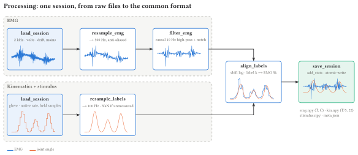
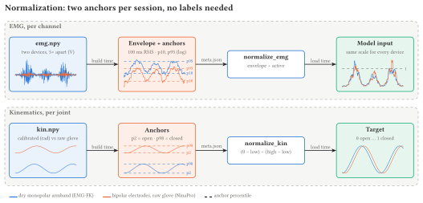

# BRI Forearm EMG World Model Dataset

Public forearm EMG + hand-kinematics datasets combined into one format (one EMG rate, units, filtering, joint
space and metadata), for training a generic EMG → hand-pose model that can transfer to amputees.

**Read [docs/data-spec.md](docs/data-spec.md) first**: requirements, decisions, dataset status and roadmap.

## Setup

```bash
python -m venv .venv && source .venv/bin/activate
pip install -e ".[dev,dvc]"
pre-commit install
dvc pull            # the processed dataset of this commit (S3 access: see HRI-ContinuousTraining/docs/dvc-access.md)
```

## The three phases

```
 PHASE 1  scripts/pull_data.py       internet  ->  data/raw/<dataset>/         (original files, untouched)
 PHASE 2  scripts/build_dataset.py   data/raw  ->  data/processed/<dataset>/   (common format)
 PHASE 3  femg.loader.EMGWindows     data/processed  ->  training windows
```

```bash
python scripts/pull_data.py --dataset emg_fk --percent 10      # 1. download the first 10% of the subjects
python scripts/build_dataset.py --dataset emg_fk --percent 10  # 2. process them
```

- `--percent` takes the first N% of a dataset's subjects (at least one). The same rule is used by both scripts and
  the loader, and the subsets are nested: the subjects of 10% are also in 30%.
- Both scripts can be stopped and started again. Files already downloaded and sessions already built with the
  same settings are skipped. `--overwrite` rebuilds everything.
- `build_dataset.py` only builds subjects whose raw files are present. Processing settings live in `params.yaml`.
- Raw data is not versioned (it can be downloaded again). `data/processed` is versioned with DVC:

```bash
python scripts/pull_data.py                      # all raw data (~40 GB)
dvc repro                                        # full build, one stage per dataset (params.yaml)
dvc push && git add dvc.lock && git commit       # share it
```

On a big CPU machine next to the bucket: `sky launch -c femg-build sky/build.yaml` (see the file).

## How a session is processed



`build_dataset.py` runs this for every session:

```python
session = dataset.load_session(subject, name, raw_dir)  # native rates, EMG in volts, canonical joints in rad
session = processor.process(session, dataset)  # resample -> filter -> labels -> align -> stats
save_session(folder, session, make_meta(dataset, session, processor))
```

`Processor.process` (`src/femg/processor.py`) is a short list of steps:

1. `resample_emg`: EMG to `fs` (500 Hz), anti-aliased.
2. `filter_emg`: causal 10 Hz high-pass + mains notches.
3. `resample_labels`: kinematics and stimulus to `label_fs` (100 Hz).
4. `align_labels`: correct the dataset's `kin_lag_s` and crop so label `k` ↔ EMG sample `k * fs / label_fs`.
5. `add_stats`: per-channel EMG and per-joint kinematics stats for normalization.

To change the build, subclass `Processor`, override or add steps, register it in `PROCESSORS` and set
`processor.name` in `params.yaml` (there is an example at the top of `processor.py`).

The output has one folder per session (`emg.npy` (T, C) volts, `kin.npy` (T/r, 22) radians/NaN,
`stimulus.npy`, `meta.json`), plus `<dataset>/sessions.parquet`. See `src/femg/save.py` for details.

## Normalization



Diagrams live in `docs/diagrams/`: one [Typst](https://typst.app) + CeTZ file per diagram (synthetic signals drawn
inside each step), sharing `style.typ`. After editing one, render it with
`python -c "import typst; typst.compile('docs/diagrams/<name>.typ', output='docs/diagrams/<name>.svg')"` (or `.pdf`).

## Explore the data

```bash
pip install -e ".[explorer]"     # once; Node.js is needed too (the dashboard builds itself on first launch)
python -m tools.explorer         # http://127.0.0.1:8080 (--host 0.0.0.0 for other machines, --no-hand without MuJoCo)
```

A dashboard over `data/processed`: pick a session, scroll the EMG (min/max per pixel + 100 ms RMS, µV or ÷ active,
ring8 or all channels), the joints (rad or 0-1) and the instructed movements on one time axis, and play it while the
Shadow Hand (mjviser, port 8081) moves in sync. Backend: `tools/explorer/` (FastAPI, memory-mapped sessions, one value
per pixel). Frontend: `tools/explorer/front/` (React + Tailwind, same look as neocoral-studio); for live reload run
`python -m tools.explorer --no-build` and `npm run dev` in `tools/explorer/front`.

## Inspect the data

```bash
pip install -e ".[viz]"
python scripts/compare_datasets.py                          # output/compare/{emg,hand}.png + PASS/FAIL table
python scripts/view_hand.py data/processed/ninapro_db8/s01/A1 --start 60   # open http://localhost:8080
```

- `compare_datasets.py`: each dataset against the pool, percentile by percentile, within the same scenario (rest,
  hold, moving: defined from the hand, `src/femg/normalize.py`). `emg.png`: ring8 RMS raw (µV) and normalized
  (/ `active`). `hand.png`: hand flexion, speed and movement bout duration. The table gates a dataset at p10..p90.
- `view_hand.py`: plays a session's `kin.npy` on the menagerie Shadow Hand (right) in the browser (mjviser), with the
  canonical name and angle on every joint, and play/pause/step/speed controls.

## Load (from the training repo)

```python
from femg.loader import EMGWindows

ds = EMGWindows(
    "data/forearm",
    datasets=["emg_fk", "ninapro_db2", "ninapro_db8"],
    percent=20,
    window_s=0.48,
    stride_s=0.08,
    montage="ring8",
    normalize="calib_rms",
)
train, val, test = ds.split_subjects(val=0.1, test=0.1)
loader = torch.utils.data.DataLoader(train, batch_size=256, shuffle=True, num_workers=8)
# batch: emg (B, 8, 240), kin (B, 22), mask (B, 22) -> loss = ((pred - kin) ** 2 * mask).sum() / mask.sum()
```

In `HRI-ContinuousTraining`:

```bash
pip install "femg @ git+ssh://git@github.com/ETHRoboticsClub/BRI-ForearmEMGWorldModelDataset.git"
dvc import git@github.com:ETHRoboticsClub/BRI-ForearmEMGWorldModelDataset data/processed -o data/forearm
```

`dvc import` pins the dataset version in the training repo's git history, and `dvc update data/forearm.dvc` moves
it to a newer build. On a machine with lots of RAM (e.g. the GPU box), pass `in_memory=True` to skip mmap page faults.

## Add a dataset

1. Create `src/femg/datasets/<name>.py` with a subclass of `Dataset` (copy `emg_fk.py`, the shortest one). Fill in
   the metadata (cite where every value comes from) and implement:
   - `subjects()`: the subject ids
   - `files_to_download(subject)`: `RemoteFile`s (url, name, optional md5, optional zip members to keep)
   - `sessions(subject)`: the session names
   - `load_session(subject, session, raw_dir)`: a `Session` with EMG in volts and canonical joints in radians
2. Add it to `DATASETS` in `src/femg/datasets/__init__.py` and to `datasets` in `params.yaml`.
3. `python scripts/pull_data.py --dataset <name> --percent 10`, then `python scripts/build_dataset.py --dataset <name>
   --percent 10 --workers 1` (one worker prints errors directly). Open one real file and record what you checked in
   `verified`.

## Structure

```
params.yaml                  build settings: datasets, percent, workers, processor
dvc.yaml                     one build stage per dataset -> data/processed/<dataset>
scripts/
  pull_data.py               PHASE 1: download raw files
  build_dataset.py           PHASE 2: load -> process -> save, in parallel over subjects
src/femg/
  joints.py                  the 22 canonical joints, label sources, units
  download.py                RemoteFile + download_file (md5, zip members)
  datasets/                  one Dataset subclass per public dataset (base.py: Dataset, Session)
  processor.py               Processor: the processing steps
  signal_utils.py            resampling, causal filter, stats
  save.py                    on-disk layout: save_session, sessions.parquet
  loader.py                  PHASE 3: EMGWindows (windows on the fly, montages, normalization, splits)
sky/build.yaml               full build on an AWS CPU machine
```
