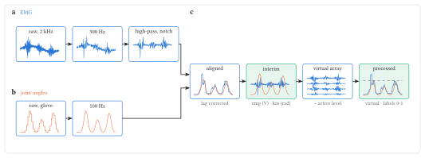
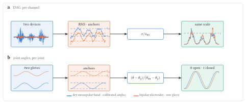
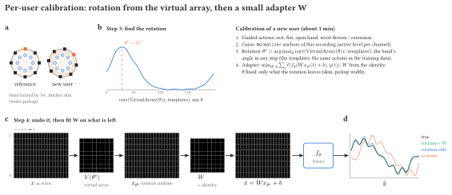
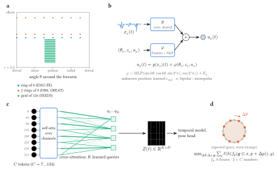

# BRI Forearm EMG World Model Dataset

Public forearm EMG + hand-kinematics datasets combined into one format (one EMG rate, units, filtering, joint
space and metadata), for training a generic EMG → hand-pose model that can transfer to amputees.

**Read [docs/data-spec.md](docs/data-spec.md) first**: requirements, decisions, dataset status and roadmap.

## Setup

```bash
python -m venv .venv && source .venv/bin/activate
pip install -e ".[dev,dvc]"
pre-commit install
dvc pull            # the processed dataset of this commit (S3 access: see HRI-ContinuousTraining/docs/dvc-access.md)
```

## The three phases

```
 PHASE 1  scripts/pull_data.py       internet  ->  data/raw/<dataset>/         (original files, untouched)
 PHASE 2  scripts/build_dataset.py   data/raw  ->  data/processed/<dataset>/   (common format)
 PHASE 3  the training repo         data/processed  ->  training windows    (see "Read the data")
```

```bash
python scripts/pull_data.py --dataset emg_fk --percent 10      # 1. download the first 10% of the subjects
python scripts/build_dataset.py --dataset emg_fk --percent 10  # 2. process them
```

- `--percent` takes the first N% of a dataset's subjects (at least one, `first_percent` in
  `src/femg/datasets/base.py`). Both scripts use the same rule, and the subsets are nested: the subjects of 10% are
  also in 30%.
- Both scripts can be stopped and started again. Files already downloaded and sessions already built with the
  same processor settings are skipped. `--overwrite` rebuilds everything: needed after changing a dataset reader,
  which the skip check does not see.
- `build_dataset.py` only builds subjects whose raw files are present. Processing settings live in `params.yaml`.
- Raw data is not versioned (it can be downloaded again). `data/processed` is versioned with DVC:

```bash
python scripts/pull_data.py                      # all raw data (>140 GB: SEEDS ~60, DB7 ~34)
dvc repro                                        # full build, one stage per dataset (params.yaml)
dvc push && git add dvc.lock && git commit       # share it
```

On a big CPU machine next to the bucket: `sky launch -c femg-build sky/build.yaml` (see the file), then
`sky/fetch.sh` brings back `dvc.lock` and the built data.

Datasets (`DATASETS` in `src/femg/datasets/__init__.py`, status and caveats in `docs/data-spec.md`): EMG-FK,
NinaPro DB2, DB3, DB4, DB7, DB8, SEEDS, KIN-MUS UJI and GREAT. DB3 and DB4 have no kinematics (stimulus only).

## How a session is processed



`build_dataset.py` runs this for every session:

```python
session = dataset.load_session(subject, name, raw_dir)  # native rates, EMG in volts, canonical joints in rad
session = processor.process(session, dataset)  # resample -> filter -> labels -> align -> stats
save_session(folder, session, make_meta(dataset, session, processor))
```

`Processor.process` (`src/femg/processor.py`) is a short list of steps:

1. `resample_emg`: EMG to `fs` (500 Hz), anti-aliased.
2. `filter_emg`: causal 10 Hz high-pass + mains notches.
3. `resample_labels`: kinematics and stimulus to `label_fs` (100 Hz). Kinematics go one segment (continuous
   recording) at a time: repeated frames of slow gloves / cameras are interpolated over (`kin_max_repeat_s`), short
   gaps too (`kin_max_gap_s`, longer ones stay NaN), and a zero-phase low-pass (`kin_lowpass`) smooths quantization
   steps and tracking jitter.
4. `align_labels`: correct the dataset's `kin_lag_s` and crop so label `k` ↔ EMG sample `k * fs / label_fs`.
5. `drop_settling`: no label for the first `settle_s` of every segment (the high-pass rings after a start or join).
6. `add_stats`: per-channel EMG and per-joint kinematics stats for normalization.

To change the build, subclass `Processor`, override or add steps, register it in `PROCESSORS` and set
`processor.name` in `params.yaml` (there is an example at the top of `processor.py`).

The output has one folder per session (`emg.npy` (T, C) volts, `kin.npy` (T/r, 22) radians/NaN,
`stimulus.npy`, `meta.json`), plus `<dataset>/sessions.parquet`. See `src/femg/save.py` for details. Two rules for
whoever reads it:

- A NaN column is a joint the dataset does not measure; a frame whose row is all NaN has **no label** (between the
  tasks of KIN-MUS UJI, right after a join). Never fill it: mask it out of the loss.
- `meta["segments"]` lists the `[start, end)` label frames of each continuous recording. Sessions joined from short
  trials (SEEDS, KIN-MUS UJI, GREAT) have one per trial: a training window must not span two.

## Normalization



## Per-user calibration: the channel-mixing adapter



A planned model design (training repo), not part of the build: a learned 8×8 matrix per user in front of a shared
encoder absorbs electrode displacement, so calibrating a new user only fits that matrix.

## Any electrode layout: the channel encoder



`femg.channel_encoder.ChannelEncoder` (PyTorch, `pip install -e ".[model]"`) turns EMG from any layout into a fixed
set of latents for the next block: `emg (B, C, T)` + `positions (B, C, 3)` + `mask (B, C)` → `(B, T/5, K, D)`. Each
channel becomes a token (shared temporal conv + an embedding of where the electrode sits), and K learned queries
attend over the C tokens, so 7, 8, 16 or 134 channels give the same output and the channel order does not matter.
Positions come from `meta["electrodes"]` (`ElectrodeLayout.from_meta(meta).positions()`, `femg.electrodes`); during
training, `layout.place_randomly(rng)` moves every band whose rotation is undocumented. For a new user, freeze
the encoder and fit an `ElectrodeCalibration` (band rotation and slide, one gain per channel).

```bash
python scripts/test_channel_encoder.py   # output/channel_encoder/report.png + PASS/FAIL table
```

It checks the model (output shape for every layout, channel order and padding ignored, positions used, a band
rotation recovered through the frozen encoder) and the data against its assumptions (correlation between channels
falls with distance, the rings of different datasets line up after one rotation, and how much pose information the
channels beyond the ring add, with a ridge decoder).

## Diagrams

`docs/diagrams/`: one [Typst](https://typst.app) + CeTZ file per diagram (synthetic signals drawn inside each step),
sharing `style.typ`. After editing one, render the SVGs that changed with `make -C docs/diagrams`.

## Explore the data

```bash
pip install -e ".[explorer]"     # once; Node.js is needed too (the dashboard builds itself on first launch)
python -m tools.explorer         # http://127.0.0.1:8080 (--host 0.0.0.0 for other machines, --no-hand without MuJoCo)
```

A dashboard over `data/processed`: pick a session, scroll the EMG (min/max per pixel + 100 ms RMS, µV or ÷ active,
ring8 (or the dataset's small montage when it has no ring) or all channels), the joints (rad or 0-1) and the
instructed movements on one time axis, and play it while a robot hand (mjviser, port 8081) moves in sync. The hand
menu lists every file in `src/femg/hand/models/` (Shadow, LEAP, Aero, MyoHand). Frames without a label show as gaps in the
plots, and the hand keeps its last pose there.

Backend: `tools/explorer/` (FastAPI, memory-mapped sessions, one value per pixel). Frontend: `tools/explorer/front/`
(React + Tailwind, same look as neocoral-studio); for live reload run `python -m tools.explorer --no-build` and
`npm run dev` in `tools/explorer/front`.

## Inspect the data

```bash
pip install -e ".[viz]"
python scripts/compare_datasets.py                          # output/compare/{emg,hand}.png + PASS/FAIL table
python scripts/estimate_kin_lag.py data/processed/emg_fk/s01/free   # where the pose best follows the EMG
python scripts/view_hand.py data/processed/ninapro_db8/s01/A1 --start 60   # open http://localhost:8080
```

- `compare_datasets.py`: each dataset against the pool, percentile by percentile, within the same scenario (rest,
  hold, moving: defined from the hand, `src/femg/normalize.py`). `emg.png`: ring8 RMS raw (µV) and normalized
  (/ `active`). `hand.png`: hand flexion, speed and movement bout duration. The table gates a dataset at p10..p90.
- `estimate_kin_lag.py`: fits a linear EMG envelope → pose decoder at every lag and prints the best one. Datasets on
  one clock land at 60-300 ms (GREAT, NinaPro DB2/DB7); much more or less means `kin_lag_s` is off.
- `view_hand.py`: plays a session's `kin.npy` on a hand model (`--hand`, default Shadow Hand) in the browser
  (mjviser), with the canonical name and angle on every joint, and play/pause/step/speed controls.

To add a hand model or change how labels drive it, see [src/femg/hand/README.md](src/femg/hand/README.md)
(`python -m tools.hands template|check`).

## Read the data (from the training repo)

There is no loader in this repo: the training repo (`HRI-ContinuousTraining`) cuts the windows. It gets the code and
a pinned dataset version with:

```bash
pip install "femg @ git+ssh://git@github.com/ETHRoboticsClub/BRI-ForearmEMGWorldModelDataset.git"
dvc import git@github.com:ETHRoboticsClub/BRI-ForearmEMGWorldModelDataset data/processed -o data/forearm
```

`dvc update data/forearm.dvc` moves it to a newer build. A session is read like this:

```python
import json
from pathlib import Path

import numpy as np

from femg.normalize import normalize_kin

folder = Path("data/forearm/ninapro_db2/s01/E1")
meta = json.loads((folder / "meta.json").read_text())
emg = np.load(folder / "emg.npy", mmap_mode="r")[:, meta["montages"]["ring8"]]  # (T, 8) volts at meta["fs"]
kin = normalize_kin(np.load(folder / "kin.npy"), meta["kin_stats"])  # (T / r, 22), 0 open .. 1 closed
r = meta["fs"] // meta["label_fs"]  # label k <-> EMG sample k * r
for start, end in meta["segments"]:  # cut windows inside one segment only
    ...
# mask = np.isfinite(kin): unmeasured joints and frames without a label
# loss = ((pred - kin) ** 2 * mask).sum() / mask.sum()
```

EMG normalization uses `meta["emg_stats"]` (`floor`, `active` per channel; `femg.normalize.normalize_emg`).

## Add a dataset

1. Describe the dataset in `src/femg/datasets/config/<name>.yaml` (copy `emg_fk.yaml`): source, rates, units, and
   its electrodes in channel order, one group per band, grid or spot:

   ```yaml
   electrodes:  # layout: ring (n, z), grid (rows, columns, pitch_mm, center), spot (angle, z) or unknown (n)
     - {name: ring, kind: bipolar, layout: ring, n: 8, z: 0.05, angle_sd: 180, z_sd: 0.05, mirror: true}
     - {name: fds, kind: bipolar, layout: spot, angle: 345, z: 0.3, angle_sd: 20, z_sd: 0.1}
   montages:
     ring8: 0-7  # named channel ranges
   notes:        # what you checked against the real files
     glove_order: ...
   ```

   Angle: degrees around the forearm (0 palmar, 90 radial, 180 dorsal); z: 0 elbow to 1 wrist; `angle_sd`,
   `z_sd`, `mirror`: how well the group's placement is known (180: any rotation). Cite every value in a comment.
2. Create `src/femg/datasets/<name>.py` with a subclass of `Dataset` that only reads the files (copy `emg_fk.py`,
   the shortest one; the config is in `self.config`). Map the file's columns to the canonical joints with a dict
   (`femg.hand.joints`: `CYBERGLOVE_22`, `CYBERGLOVE_18`, `FINGER_FLEXIONS`, or your own) and implement:
   - `subjects()`: the subject ids
   - `files_to_download(subject)`: `RemoteFile`s (url, name, optional md5, optional zip members to keep)
   - `sessions(subject)`: the session names
   - `load_session(subject, session, raw_dir)`: a `Session` with EMG in volts and canonical joints in radians.
     Leave kinematics NaN where nothing was measured (never hold a pose), and when joining trials use
     `concat_trials` and pass its starts as `segments`.
3. Add it to `DATASETS` in `src/femg/datasets/__init__.py` and to `datasets` in `params.yaml`.
4. `python scripts/pull_data.py --dataset <name> --percent 10`, then `python scripts/build_dataset.py --dataset <name>
   --percent 10 --workers 1` (one worker prints errors directly). Open one real file and record what you checked in
   the config's `notes`.
5. Check the joint signs on the dataset's instructed movements (table in `src/femg/hand/README.md`), and the
   EMG-to-kinematics delay with `scripts/estimate_kin_lag.py` (set `kin_lag_s` if it is far from 60-300 ms).

## Structure

```
params.yaml                  build settings: datasets, percent, workers, processor
dvc.yaml                     one build stage per dataset -> data/processed/<dataset>
docs/
  data-spec.md               requirements, decisions, dataset status, roadmap
  diagrams/                  Typst sources + rendered SVGs (make -C docs/diagrams)
scripts/
  pull_data.py               PHASE 1: download raw files
  build_dataset.py           PHASE 2: load -> process -> save, in parallel over subjects
  compare_datasets.py        each dataset against the pool (EMG levels, hand flexion and speed)
  estimate_kin_lag.py        EMG -> pose delay of processed sessions
  test_channel_encoder.py    checks of the channel encoder and of the data for it
  view_hand.py               play a session on a hand model in the browser
src/femg/
  download.py                RemoteFile + download_file (md5, zip members)
  datasets/                  one reader per public dataset (base.py: Dataset, DatasetConfig, Session)
    config/                  one YAML per dataset: source, rates, units, electrodes, montages, notes
  processor.py               Processor: the processing steps
  signal_utils.py            EMG resampling, causal filter, envelope; kinematics rebuild (resample_kin)
  save.py                    on-disk layout: save_session, meta.json, sessions.parquet
  normalize.py               0-1 kinematics, EMG / active, display montage, rest/hold/moving scenarios
  electrodes.py              ElectrodeGroup, ElectrodeLayout: where every channel sits on the arm
  channel_encoder.py         ChannelEncoder: any electrode layout -> fixed latents (PyTorch, .[model])
  hand/
    joints.py                the 22 canonical joints (the labels), label sources, units, glove sensor maps
    mapping.py               HandMap: which label drives each joint of a 3D hand model
    geometry.py, scene.py    the hand's anatomical frame; HandScene, the browser viewer
    builders.py              models built in code (MyoHand without the arm)
    models/                  one JSON mapping per hand model (README.md: format, thumb, dataset signs)
tools/
  explorer/                  the data dashboard (python -m tools.explorer)
  hands/                     write and check hand mappings (python -m tools.hands)
sky/                         full build on an AWS CPU machine (build.yaml) and fetching its result (fetch.sh)
```
